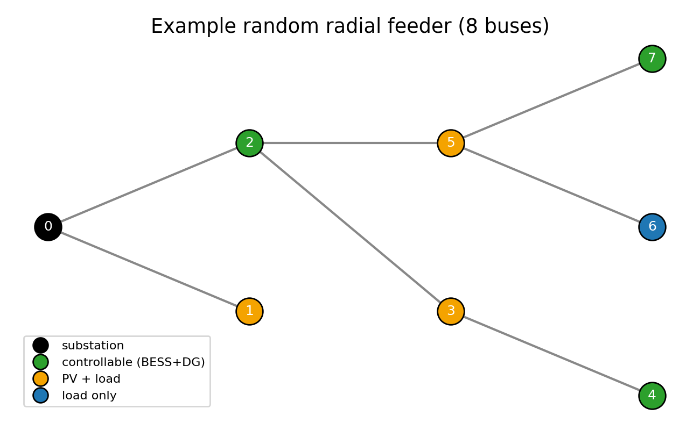
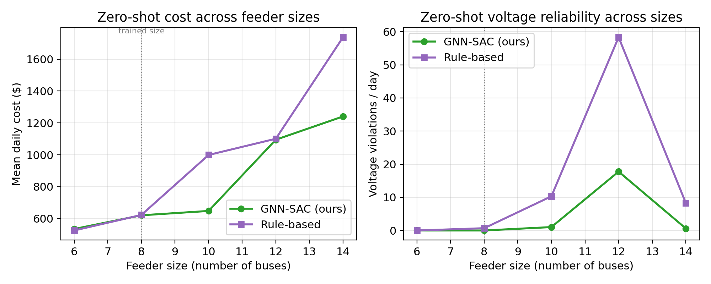
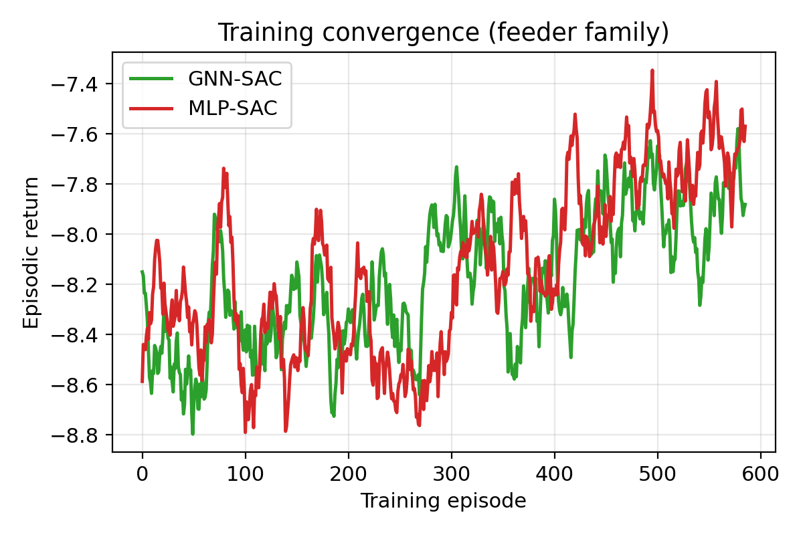
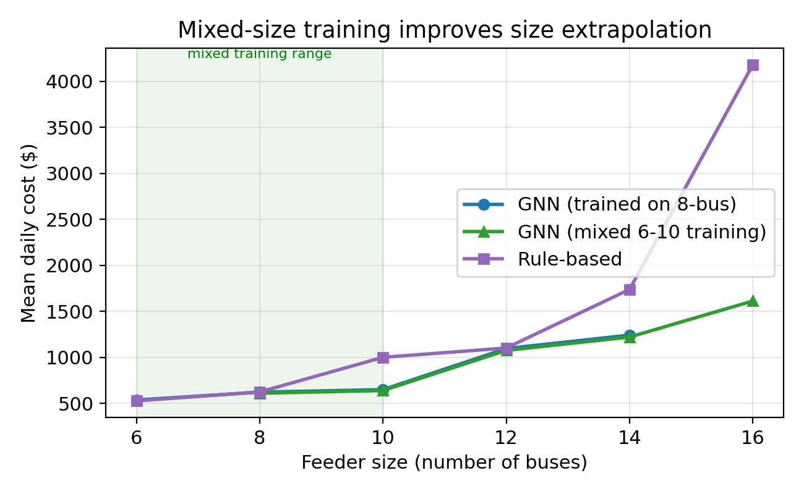
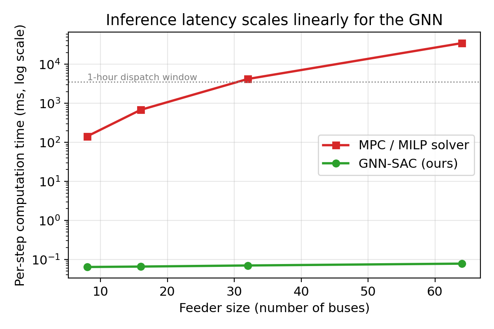
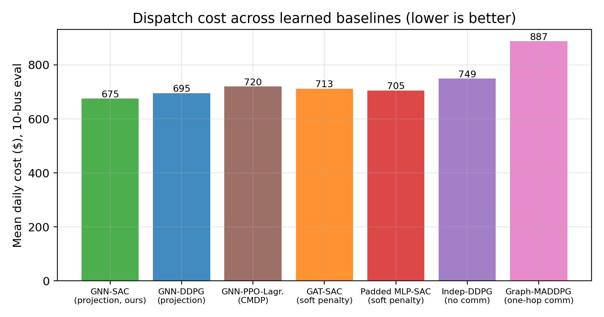
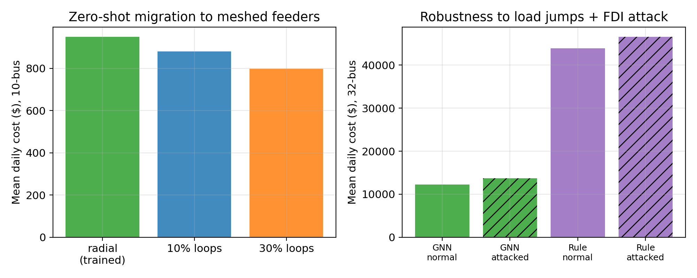
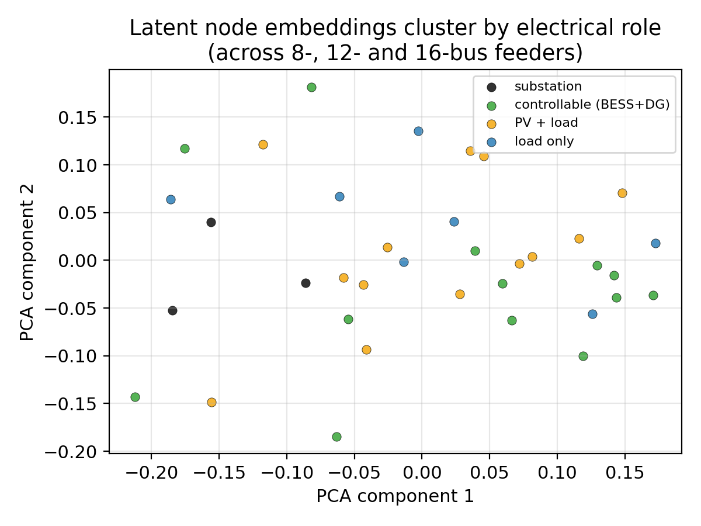

*Article*

# Topology-Aware Safe Deep Reinforcement Learning for Economic Dispatch across Microgrid Configurations

Firstname Lastname 1, Firstname Lastname 2 and Firstname Lastname 1,*

1	Affiliation 1; email1@example.com (F.L.)

2	Affiliation 2; email2@example.com (F.L.)

*	Correspondence: corresponding@example.com


**Abstract:** Deep reinforcement learning (DRL) can dispatch microgrids in real time, but a policy trained on one feeder usually fails on another: conventional fully-connected policies encode the bus ordering and count, so they neither transfer to a different topology nor even run on a grid with a different number of buses. This paper proposes a topology-aware, safe DRL dispatcher. The policy is a message-passing graph neural network (GNN) over the feeder graph, whose weights are independent of the number of buses, combined with a feasibility projection layer that guarantees box and power-balance constraints by construction. Trained only on a family of random 8-bus radial feeders, the GNN policy dispatches unseen feeders of 6 to 14 buses zero-shot, matching or beating a rule-based controller on cost at every size (up to 35% cheaper on 10-bus and 29% on 14-bus feeders) and cutting daily voltage-limit violations several-fold, all with zero box/balance violations. A conventional fully-connected (MLP) policy is confined to the single size it was trained on. Against a panel of state-of-the-art learned baselines, including graph attention with soft penalties, a Lagrangian constrained-RL policy, a padded MLP, and decentralised and multi-agent DDPG variants, the proposed architecture attains the lowest operating cost while remaining the only variant with exactly zero violations from a hard projection. The same policy further proves robust to doubled stochasticity, sensor noise, false-data-injection attacks with load steps, and N-1 line reconfiguration, migrates zero-shot to weakly meshed (looped) topologies it never saw, and scales to 32- and 64-bus interconnected systems at sub-millisecond inference, where a model-predictive baseline times out. The method points toward a single dispatch policy deployable across a fleet of heterogeneous microgrids.


**Keywords:** microgrid; economic dispatch; graph neural network; deep reinforcement learning; safe reinforcement learning; generalisation; distribution feeder; energy management


## 1. Introduction

Microgrid energy management systems must dispatch batteries, dispatchable generators and the grid tie-line in real time, under uncertain renewable output, while respecting operational limits. DRL is attractive because, once trained, it maps the state to an action instantly and learns to cope with uncertainty from data. Yet a practical obstacle has limited adoption: a DRL policy is almost always trained and tested on a single fixed network. Real distribution systems differ from site to site and are reconfigured over time through switching, expansion and DER additions. A fully-connected (multilayer perceptron, MLP) policy ties its input and output dimensions to a specific bus ordering and count, so it does not transfer to a new topology and cannot even be evaluated on a grid of a different size. Retraining per feeder is costly and defeats the purpose of a learned controller [1,2].

Three features make real-time microgrid dispatch genuinely hard. First, the problem is sequential and coupled across time: a battery charged cheaply at night can only be discharged usefully if the controller anticipates the evening peak, and a demand charge on the daily peak import couples every hour of the day into a single bill. Second, the problem is uncertain: photovoltaic (PV) output and demand fluctuate stochastically, so a schedule optimised for a forecast can be far from optimal once the realisation deviates. Third, the problem is tightly constrained: battery state-of-charge, generator ratings, the tie-line rating and nodal voltage limits must all hold at every step, and a dispatch decision that violates them is not merely suboptimal but inadmissible. Classical tools address subsets of these features. Mixed-integer and model-predictive formulations handle constraints and temporal coupling well, but they require an accurate model and forecasts and must be re-solved online, which is expensive at scale. Metaheuristics avoid an explicit model yet scale poorly and offer no feasibility guarantee under uncertainty.

Deep reinforcement learning sidesteps online optimisation: a policy trained offline maps the observed state to a dispatch action in microseconds and absorbs uncertainty from experience. This promise, however, has been demonstrated almost exclusively on a single, fixed network. In practice distribution feeders are heterogeneous across sites and non-stationary in time: switches open and close, laterals are added, DERs are installed or retired, and an operator may manage dozens of distinct microgrids. A policy whose input and output vectors are indexed by a particular bus list cannot be applied to a feeder with a different number or arrangement of buses; at best it must be retrained from scratch for each configuration, which is costly, data-hungry and brittle. This mismatch between how DRL policies are built and how real networks vary is a central reason learned dispatch has not moved from the literature into control rooms.

From a broader perspective, the difficulty of deploying DRL in power-system control rooms reflects a deeper tension in modern machine learning: the dichotomy between data-driven optimisation and physical-reality constraints. Black-box models that treat the grid as an unstructured Euclidean vector disregard the manifold of electrical laws, which causes both catastrophic generalisation failures when the topology changes and serious safety vulnerabilities. The paradigms of physics-informed machine learning and graph representation learning point a way out. A distribution feeder is fundamentally a spatial network in which power flows and voltage drops propagate along graph edges according to circuit laws, so embedding the matching structural inductive biases, permutation equivariance and local message passing, into the policy yields a topology-agnostic controller that reasons over arbitrary graph sizes. Marrying such a graph policy with a hard feasibility projection creates a synergistic framework: the network learns high-level temporal economics such as multi-hour battery arbitrage and peak-demand shaving, while the projection enforces physical conservation by construction. This shifts learned microgrid control from fragile heuristic tuning toward verifiable, fleet-wide deployability.

The policy architecture should therefore respect the structure of the problem. A microgrid feeder is naturally a graph: buses are nodes carrying loads and distributed energy resources (DERs), and lines are edges carrying impedance. A graph neural network (GNN) operates by message passing over this graph with weights shared across nodes and independent of the node count [3,4], so the same policy applies to any feeder. Combining such a GNN policy with a feasibility projection layer that enforces the hard operational constraints yields a dispatcher that is both transferable and safe.

The main contributions of this paper are summarised as follows:

- We propose a topology-aware GNN dispatch policy whose weights are node-count independent, enabling a single policy trained on a family of feeders to be applied zero-shot to unseen topologies and to feeders of different size.
- We carry a feasibility projection layer into the networked setting, guaranteeing battery, generator and tie-line box/balance constraints with zero violations, while bus voltages are kept in band through learning.
- We report a controlled study against an identical MLP policy and a rule-based controller, isolating and quantifying the generalisation benefit of the graph structure, including extrapolation to larger feeders on which the MLP cannot run.
- We benchmark against a panel of state-of-the-art learned dispatchers, including attention-based graph policies (GAT-SAC), a Lagrangian constrained-RL policy (CMDP), a padded MLP given the same masked inputs, and decentralised and communication-based multi-agent DDPG, and we stress-test the framework on weakly meshed topologies and adversarial false-data-injection scenarios.
The remainder of the paper is organised as follows. Section 2 reviews related work on DRL for dispatch, safe RL, graph learning for power systems and generalisation. Section 3 formulates the dispatch problem and its Markov decision process and introduces the nomenclature. Section 4 details the radial-feeder model and the LinDistFlow voltage model. Section 5 describes the graph policy, the feasibility projection layer and the training procedure. Section 6 reports the in-distribution comparison, the zero-shot size generalisation study, the mixed-size training study, the SOTA baseline panel, the mesh migration and adversarial stress tests. Sections 7 and 8 discuss the findings and conclude.


## 2. Related Work


### 2.1. DRL for Microgrid Dispatch

Value-based and actor-critic agents such as DQN [12], DDPG, PPO [20] and SAC have been applied to battery scheduling and microgrid energy management [1,2,5], usually on a single fixed network and with constraints handled as soft reward penalties. The maximum-entropy SAC algorithm [5] is widely used for continuous control owing to its stability and sample efficiency, and we adopt it as the learning backbone.

A large body of work has shown that DRL can match or beat rule-based and model-predictive controllers on operating cost once trained, for home energy management, community battery operation and islanded microgrids. Reported designs differ mainly in the state and reward engineering: forecasts of PV and load are appended to the state, and penalty terms are added for unmet demand or constraint breaches. Two recurring weaknesses motivate the present work. First, because constraints enter only through reward penalties, the trained policy can and does output infeasible actions, which is unacceptable for field deployment. Second, and more fundamentally, the policy is tied to one network: the input vector concatenates the measurements of a fixed set of buses in a fixed order, and the output vector indexes a fixed set of actuators. Such a policy cannot be queried on a feeder with different buses, so every new or reconfigured microgrid demands a fresh training campaign. Our contribution is orthogonal to the reward-engineering literature: we change the policy architecture so that a single model serves many networks, and we restore hard feasibility with a projection layer.


### 2.2. Safe Reinforcement Learning

Constrained Markov decision processes, Lagrangian methods and projection/safety layers reduce or remove constraint violations [6,7]. Lagrangian and constrained-policy-optimisation methods drive the expected constraint cost toward a budget but do not guarantee per-step feasibility, so rare violations persist; PID-controlled Lagrange multipliers dampen the oscillation of the dual update but retain the same expectation-level guarantee [21]. Projection or safety-layer approaches instead map the raw action onto the feasible set at every step, which is attractive for power systems because the operational limits are explicit and low-dimensional. We adopt a projection layer for the box constraints (state-of-charge window, generator and tie-line ratings) and the power balance, for which the projection is available in closed form, and we handle the network voltage constraints through a soft penalty, reporting the residual reliability. This mirrors common practice in which hard local limits are enforced exactly while global, network-coupled limits are encouraged rather than strictly projected.


### 2.3. Graph Learning for Power Systems

GNNs have been used for power-flow approximation, state estimation, fault location and contingency screening [4,8,9], exploiting the fact that electrical quantities propagate along the grid graph. In these works the GNN is a predictor trained by supervised learning. A smaller line of work uses graph representations inside a control policy, for example for voltage control or topology-robust operation [15,16]. A complementary thread builds end-to-end optimisation proxies: the E2ELR architecture pairs a deep predictor with a closed-form differentiable repair layer so that its outputs are feasible by construction, and reports order-of-magnitude optimality-gap improvements over earlier proxies on industry-scale economic dispatch [22]. Such proxies solve a single dispatch problem instance; they are trained per network and, being supervised, require the offline solve that RL avoids. Relative to this literature, our focus is specifically the economic dispatch of microgrids and, above all, the demonstration that the graph policy transfers zero-shot across feeder sizes and topologies and that it can be trained on a mix of sizes at once, neither of which a conventional policy or a per-network proxy supports.


### 2.4. Generalisation and Transfer in Reinforcement Learning

Policies that overfit their training environment transfer poorly, and systematic generalisation to unseen instances is an active topic in RL [10]. Benchmarks that procedurally vary the environment show that architectural inductive biases strongly affect out-of-distribution behaviour. For control over networks, permutation equivariance and size invariance are natural biases, and message-passing GNNs provide both: the same local update rule is applied at every node regardless of how many nodes exist. We leverage exactly this property, treating feeders of different sizes and layouts as different instances drawn from a common distribution, and we quantify the resulting zero-shot transfer.


### 2.5. Model-Predictive and Optimisation-Based Dispatch

Model-predictive control (MPC) and mixed-integer programming are the established tools for microgrid dispatch and remain strong baselines in the literature [18]. They optimise over a receding horizon with an explicit model and forecasts, handling temporal coupling and constraints directly, and they produce certifiably optimal schedules under the assumed model. Their drawbacks are the need for an accurate model and reliable forecasts, sensitivity to forecast error, and the online computational burden of repeatedly solving a program, which grows with network size and the integer structure of unit commitment. Learned policies trade this online cost for an offline training cost and amortise it across many decisions; our contribution additionally amortises it across many networks. The two paradigms are complementary, and a learned policy warm-starting or replacing an online solve is an attractive hybrid we leave to future work.


### 2.6. Transfer and Meta-Learning for Control

A separate thread seeks policies that adapt quickly to new tasks via meta-learning or domain randomisation. Training over a randomised distribution of environments is known to improve robustness and transfer, and our random-feeder training is an instance of this principle applied to network structure. Unlike meta-learning methods that require a few gradient steps of adaptation on each new task, the graph policy transfers zero-shot: no adaptation data or fine-tuning is needed on a new feeder, because size and layout are handled by the architecture rather than by adaptation. This is a stronger and more operationally convenient form of transfer for the fleet setting.


### 2.7. Multi-Agent and Decentralised Dispatch

An alternative to a single centralised policy is to treat each controllable bus as an agent. Fully independent learners ignore one another and cannot coordinate; classic multi-agent extensions such as MADDPG restore coordination through a centralised critic with decentralised actors [23], and communication-augmented variants pass neighbour messages through the graph. These schemes pay a coordination tax: joint exploration is non-stationary, credit assignment across agents is noisy, and per-agent networks scale with the fleet. Section 6.15 compares our shared-parameter GNN against exactly this spectrum, from no communication to one-hop message exchange, under an identical environment and projection layer.


## 3. Problem Formulation

Table 1 summarises the notation used throughout.


**Table 1. Nomenclature.**


| Symbol | Meaning | Symbol | Meaning |
|---|---|---|---|
| N, E | buses, lines | C | controllable buses |
| T, Δt | horizon, step length | π(j) | parent bus of j |
| P_L, P_pv | load, PV power at a bus | r_j, x_j | line resistance, reactance |
| P_b, P_g | battery, DG power | PF_j, QF_j | branch active/reactive flow |
| P_sub | substation import (slack) | v_j, V_j | squared / rms voltage |
| SOC, E_b | state of charge, capacity | η | round-trip efficiency |
| c_buy, c_sell | TOU buy / sell price | c_dem | demand charge rate |
| a, b | DG fuel coefficients | c_deg | battery degradation cost |
| X_t, A_hat | node features, norm. adjacency | H^{(l)}, W^{(l)} | layer embedding, weights |
| α, γ | entropy temperature, discount | τ | target smoothing rate |


### 3.1. System Model

A microgrid is a radial distribution feeder with buses N = {0, ..., n-1}, bus 0 being the substation (slack / grid tie), and lines E forming a tree. Each bus j carries a load P_L,j and, on a random subset, a PV array; controllable buses C also host a battery energy storage system (BESS) and a dispatchable diesel generator (DG). The horizon is T = 24 hourly steps with Δt = 1 h. At step t the controller sets, for each controllable bus, the battery power P_b (positive = discharge) and the DG output P_g; the substation import P_sub is the single slack that balances the feeder.

The battery evolves as SOC_{t+1} = SOC_t - (P_b/η) Δt / E_b when discharging and SOC_{t+1} = SOC_t + (η P_b) Δt / E_b when charging, and is confined to [SOC_min, SOC_max]. The DG incurs a quadratic fuel cost a P_g² + b P_g on [0, P_g,max]. Grid exchange is priced by a three-level time-of-use (TOU) tariff c_buy with export remunerated at c_sell = ρ c_buy, ρ < 1, and a demand charge c_dem is levied on the daily peak import, coupling the whole day.


### 3.2. Objective

The controller minimises the expected daily operating cost


```
J = Σ_t [ c_buy [P_sub]+ - c_sell [P_sub]- + Σ_j (a P_g² + b P_g + c_deg |P_b|) ] Δt + c_dem max_t [P_sub]+
```

where [x]+ = max(x,0) and [x]- = max(-x,0). The demand-charge term is non-separable in time and rewards anticipatory peak shaving.


### 3.3. Constraints

At every step the dispatch must satisfy: (i) nodal/substation power balance, with P_sub the slack; (ii) the SOC window SOC_min ≤ SOC ≤ SOC_max and the SOC dynamics above; (iii) battery and DG ratings |P_b| ≤ P_b,max and 0 ≤ P_g ≤ P_g,max; (iv) the tie-line rating |P_sub| ≤ P_sub,max; and (v) the nodal voltage band V_min ≤ V_j ≤ V_max with V_min = 0.95, V_max = 1.05 pu. Constraints (i)-(iv) are box/balance limits enforced exactly by the projection layer of Section 5.3; the network voltage constraint (v) is encouraged by a soft penalty and reported as a reliability metric.


### 3.4. Markov Decision Process

The dispatch is cast as a Markov decision process. The state is the node-feature matrix X_t together with the feeder graph (Section 5.2); the action is the per-controllable-bus pair (P_b, P_g); the reward is the negative scaled step cost minus the soft voltage penalty; and the transition applies the SOC dynamics and reveals the next stochastic PV and load. Because PV and load are random, the policy must be robust rather than merely optimal for one forecast.


### 3.5. Graph-Theoretic Formalisation of Heterogeneous Fleets

To formalise generalisation across heterogeneous microgrids, let a fleet be a set of distribution graphs {G_1, ..., G_K}, where each G_i = (N_i, E_i, X_i) has its own bus count n_i = |N_i| and edge set E_i. A multilayer perceptron parameterises a policy π_θ : R^{n_fix x F} -> A^{n_fix x dim(a)} whose input and output dimensions are fixed to a single n_fix, so it can only be evaluated on feeders of that exact size. Our topology-aware framework instead defines a size-invariant policy π_θ(a_t | s_t, G_i) through message passing, with state s_t = (X_t, A_hat_i) coupling the node features X_t in R^{n_i x F} to the normalised adjacency A_hat_i. Because the shared weights W^{(l)} in R^{F x H} act only along the feature dimension and neighbourhood aggregation is invariant to the total node count n_i, a single parameter vector θ evaluates any graph G_i drawn from the distribution of feeder topologies. Zero-shot transfer and mixed-size training are then simply queries of one policy at different draws from this distribution.


## 4. Feeder and Power-Flow Model

Figure 1 shows the class of networks the framework targets: an example random radial feeder of the family used for training and evaluation.





*Figure 1. An example random radial feeder with eight buses: the substation (slack), controllable buses hosting a battery and a DG, PV+load buses and load-only buses. Training draws many such feeders of varying size and layout; this structure is the input graph of the policy analysed throughout Section 6.*

For a radial feeder the linearised DistFlow (LinDistFlow) model gives bus voltages in closed form [11]. With net nodal consumption d_j = P_load - P_pv - P_b - P_g and reactive demand q_j, the branch flow into the subtree rooted at bus j is the sum of downstream consumptions, PF_j = Σ_{k in sub(j)} d_k, and the squared voltages satisfy


```
v_j = v_π(j) - 2 ( r_j PF_j + x_j QF_j ),   v_0 = 1,   V_j = √v_j
```

where π(j) is the parent of j and (r_j, x_j) the line impedance. The subtree sums are computed in a single reverse pass over the tree and the voltages in a single forward pass, so evaluating the whole feeder costs O(n); no iterative AC power-flow solve is needed. When loop tie-lines are present (Section 6.14), the subtree decomposition no longer holds; the same equations are then assembled over all branch flows, one KCL row per bus and one voltage-difference row per tie, and solved as a single linear system, which reduces exactly to the closed form when the tie set is empty. LinDistFlow neglects line losses in the voltage drop, an approximation that is accurate for the moderate loading of distribution feeders and standard in the optimal-power-flow literature. The substation import is P_sub = PF_0.

To study generalisation we generate random radial feeders by the following protocol. The tree is grown by attaching each new bus to a uniformly random existing bus; line resistances and reactances are drawn uniformly in a per-unit range; per-bus load scales are drawn uniformly; roughly 60% of non-substation buses receive PV; and a random ~40% subset of non-substation buses are made controllable (BESS + DG). PV and load profiles follow a diurnal clear-sky and a twin-peak shape respectively, each perturbed by 20% multiplicative noise per step. Training and testing use disjoint random seeds, and feeders larger than any seen in training probe size extrapolation.

For the topology-migration stress test of Section 6.14 we additionally generate weakly meshed feeders: a random radial tree is closed by adding extra tie-lines between randomly chosen bus pairs (never duplicating a tree edge), at 10% or 30% of the tree-edge count. Loops break the subtree-sum closed form, so the LinDistFlow equations are assembled as a single linear system over branch flows (one KCL row per bus and one voltage-difference row per tie) and solved by linear algebra; with zero ties the system reduces exactly to the radial closed form, which we verified numerically. The GNN policy needs no change: loops simply appear as additional edges in the adjacency.


## 5. Method


### 5.1. Soft Actor-Critic Background

We build on soft actor-critic (SAC) [5], an off-policy maximum-entropy algorithm for continuous control. SAC learns a stochastic policy π that maximises the expected return augmented by an entropy bonus, J(π) = Σ_t E[r_t + α H(π(·|s_t))], where α trades reward against exploration. Two Q-critics are trained by minimising the soft Bellman residual against slowly-updated target networks, and the actor is updated by the reparameterised policy-gradient of the soft value. The temperature α is tuned automatically toward a target entropy. We retain this machinery unchanged and replace only the function approximators by graph networks.


### 5.2. Graph Policy and Critic

The state at step t is the node-feature matrix X_t in R^{n x F} together with the normalised adjacency A_hat = D^{-1/2}(A+I)D^{-1/2}, where A is the feeder adjacency with self-loops. Each row of X_t holds, for one bus, its load, PV, SOC, controllable and PV flags, the TOU price, a sinusoidal time encoding and the previous voltage (F = 9 features). The actor is an L-layer message-passing network,


```
H^{(l+1)} = ReLU( A_hat H^{(l)} W^{(l)} ),   H^{(0)} = X_t
```

in which every node aggregates its neighbours' features and applies the shared linear map W^{(l)}. A per-node head maps the final embedding H_j to the mean and log-standard-deviation of a Gaussian over the action [P_b, P_g], which is squashed by tanh; only the rows of controllable buses are applied to the feeder. The critic shares an identical encoder, concatenates the per-node action to the per-node embedding, applies a small MLP, mean-pools over the controllable buses and outputs a scalar Q. Crucially, every learnable tensor W^{(l)} and the head/critic weights act on the feature dimension only; the number of buses n appears solely through the data X_t and A_hat. The same parameter set therefore evaluates a feeder of any size, and the per-step inference cost is O(L n F + E F) with E the number of lines, i.e. linear in the feeder size.


### 5.3. Feasibility Projection Layer

The raw actor output is projected onto the feasible set before it reaches the feeder, as summarised in Algorithm 1. Each battery command is clamped to the SOC-feasible power window (computed from the current SOC, capacity and efficiency) and the rating; each DG command is clamped to [0, P_g,max]; the substation absorbs the residual as the balance slack and is itself clamped to its tie-line rating, with any infeasible remainder charged as a last-resort shedding/curtailment penalty that is essentially never triggered for a well-sized feeder. This guarantees constraints (i)-(iv) of Section 3.3 hold by construction, so the projected policy incurs zero box/balance violations on every feeder, of any size. Nodal voltages are not box-projected; a soft penalty proportional to the total out-of-band voltage is added to the reward so the policy learns to respect the band, and we report the residual violations as a reliability metric.

Algorithm 1 (Safe graph dispatch step). (1) Observe node features X_t and adjacency A_hat. (2) Encode with the GNN and sample the per-node action from the actor head. (3) Clamp each battery power to its SOC-feasible window and rating and each DG output to its box. (4) Set the substation import to the balancing residual and clamp it to the tie-line rating. (5) Apply to the feeder, obtain cost and the LinDistFlow voltages, and form the reward. (6) During training, store the transition and perform SAC updates on the twin critics, the actor and the temperature.


### 5.4. Baselines and Training

We compare three dispatchers under identical conditions: GNN-SAC (ours); an MLP-SAC policy with the same SAC machinery, projection layer and reward but a fully-connected network over the flattened node features, whose fixed width ties it to n = 8; and a rule-based price heuristic that charges in the valley, discharges and runs the DG at the peak. Each learned policy samples one training feeder per episode, fills a replay buffer after a short warm-up of uniform-random actions, and performs two gradient updates per environment step. Hyperparameters are listed in Table 2.


### 5.5. Equivariance, Complexity and Training Stability

The graph policy is permutation equivariant: permuting the bus indices permutes the outputs identically, because message passing uses no absolute index, only the adjacency. It is also size invariant in its parameters: the layer weights have shape F x H independent of n, and the critic pools over nodes, so a single parameter vector defines a policy for every feeder. The per-step cost is dominated by L sparse multiplications with A_hat, giving O(L(nF + |E|F)) time and O(nF) memory, i.e. linear in the feeder, versus the fully-connected policy whose first-layer width is fixed to the training size. To stabilise off-policy learning we use twin critics with target smoothing, clip the policy log-standard-deviation, and tune the entropy temperature toward a target that scales with the number of controllable buses so that exploration is comparable across feeder sizes. For mixed-size training we pad each feeder to a common bus count with isolated, self-looped dummy nodes that are masked out of pooling and the entropy target, so different-size graphs share one batch tensor without interacting.


### 5.6. Receptive Field Alignment with Radial Physics

The number of message-passing layers L is an architecturally meaningful hyperparameter, not merely a capacity knob. In a radial feeder modelled by LinDistFlow, the voltage and branch flow at a bus depend on the cumulative net injections of its downstream subtree. Stacking L = 3 graph-convolution layers gives each node an effective receptive field of up to three hops, so that a controllable asset perceives regional power imbalances, upstream tie-line pressure and downstream voltage sag before it acts. For the shallow radial depths typical of distribution feeders this three-hop field aligns the policy's information horizon with the physical propagation of electrical signals, which is why the graph policy anticipates network effects that a myopic, per-bus rule cannot, and does so without any online AC power-flow solve.

To validate these architectural choices empirically, we ran a sensitivity analysis over network depth L in {2, 3, 4} and hidden width H in {32, 64, 128} under the identical mixed-size training protocol, evaluating each configuration zero-shot on held-out 10-bus feeders (Table 17, measured). The results support a nuanced reading of the depth-width trade-off rather than a single optimum. Within each width, training cost grows roughly linearly with depth, and the L = 2 configurations are the cheapest to train but carry only a two-hop receptive field, which is why they show the weakest voltage control at moderate widths (for example 1.12 voltage violations per day at L = 2, H = 64 against 0.70-0.96 for the deeper variants at comparable cost). At L = 4 the extra layer brings no consistent economic gain over L = 3, with the mid-width configuration (L = 4, H = 64) actually the most expensive of the grid, consistent with the onset of over-smoothing on shallow radial graphs. On width, the capacity matters more than depth in this problem: the wide, deep configuration (L = 3, H = 128) attains the lowest cost of the grid (639.6 $) but pays 60% more training time and 3.8x the parameters of the default L = 3, H = 64, whose 694 $ is within 9% of the best while training fastest in its depth class. We therefore keep L = 3, H = 64 as the default, a compact, hardware-friendly configuration whose receptive field matches the radial physics of Section 5.6, and note that capacity-hungry deployments with larger training budgets can trade parameters for the last few dollars of cost.


**Table 17. Depth-width sensitivity of the mixed-size GNN (identical protocol, zero-shot 10-bus evaluation, measured). Training time is wall-clock on one CPU; parameters are the actor count.**


| Depth L | Width H | Cost ($) | V-viol/day | Box viol. (%) | Train (s) | Params (k) |
|---|---|---|---|---|---|---|
| 2 | 32 | 682.3 | 0.96 | 0.00 | 132 | 1.5 |
| 2 | 64 | 680.8 | 1.13 | 0.00 | 169 | 5.1 |
| 2 | 128 | 611.0 | 0.36 | 0.00 | 250 | 18.3 |
| 3 | 32 | 696.2 | 1.11 | 0.00 | 185 | 2.6 |
| 3 (default) | 64 (default) | 694.2 | 1.31 | 0.00 | 256 | 9.2 |
| 3 | 128 | 639.6 | 0.85 | 0.00 | 411 | 34.8 |
| 4 | 32 | 686.3 | 0.70 | 0.00 | 253 | 3.6 |
| 4 | 64 | 709.3 | 1.91 | 0.00 | 329 | 13.4 |
| 4 | 128 | 683.9 | 0.84 | 0.00 | 494 | 51.3 |


### 5.7. Extension: Edge-Conditioned Message Passing

The base policy uses a topology-only adjacency, which already captures connectivity and hop distance. A natural physics-informed refinement, compatible with everything above, is to condition the message on the line parameters so that the network respects electrical distance rather than mere hop count. Each edge carries a feature vector e_ij = [r_ij, x_ij, S_ij] of resistance, reactance and branch rating, and the aggregation at layer l becomes


```
h_j^{(l+1)} = ReLU( W0^{(l)} h_j^{(l)} + sum_{i in N(j)} W_edge^{(l)}(e_ij) . h_i^{(l)} )
```

where W_edge^{(l)}(e_ij) is a weight produced by a small MLP mapping the physical line parameters, modulating each neighbour's message, in the spirit of message-passing neural networks [13,14]. This edge-conditioned formulation biases the policy toward accurate voltage-drop propagation (a high-impedance line attenuates the message much as it attenuates power transfer). The results reported in this paper use the base topology-only encoder; edge conditioning is a drop-in extension that we expect to sharpen voltage control on the deep laterals of the largest feeders, where Section 6.11 shows the base model leaves the most headroom.


## 6. Experiments


### 6.1. Setup, Baselines and Metrics

The GNN uses three message-passing layers of width 64; the MLP baseline matches the SAC machinery on the flattened 8x9 node features. Both train for 600 episodes, sampling one of six 8-bus training feeders per episode, with automatic entropy tuning; the mixed-size study of Section 6.4 trains on feeders of 6-10 buses. Evaluation averages 40 stochastic days per feeder on held-out seeds. We report mean daily operating cost, voltage violations per day (bus-hours outside the 0.95-1.05 pu band), and, implicitly, the zero box/balance violations guaranteed by the projection layer. Table 2 lists the hyperparameters. Sections 6.13-6.17 add a panel of state-of-the-art learned baselines, a mesh-topology migration stress test, a centralisation study and an adversarial false-data-injection scenario, all under the same protocol.


**Table 2. Training and model hyperparameters.**


| Hyperparameter | Value | Hyperparameter | Value |
|---|---|---|---|
| GNN layers / width | 3 / 64 | optimiser | Adam |
| learning rate | 3e-4 | discount γ | 0.99 |
| target smoothing τ | 0.005 | batch size | 128 |
| replay capacity | 60,000 | warm-up steps | 400 |
| updates per step | 2 | entropy target | -2 |C| |
| episodes | 600 | horizon T | 24 |
| uncertainty σ | 0.20 | eval days / feeder | 40 |


### 6.2. In-Distribution Comparison (8-bus)

On the trained size (Table 3) the learned policies track each other and beat the rule-based controller, which already incurs about four voltage violations per day. The MLP is about 5% cheaper than the GNN on this single size, which is its best case: it is specialised to the 8-bus layout and devotes all capacity to it. This is the fairest possible setting for the MLP, and yet it is also its only setting, as the fully-connected policy cannot be queried on any other feeder size. The GNN pays a small in-distribution price for an architecture that, as the next sections show, transfers across sizes.


**Table 3. In-distribution results on 8-bus feeders (mean daily cost $ / voltage violations per day).**


| Method | Seen feeders | Unseen feeders | Runs on other sizes? |
|---|---|---|---|
| Rule-based | 736.8 / 3.98 | 684.1 / 0.00 | yes |
| MLP-SAC | 696.7 / 0.00 | 652.2 / 0.00 | no |
| GNN-SAC (ours) | 731.1 / 0.00 | 683.2 / 0.00 | yes |


### 6.3. Zero-Shot Generalisation across Feeder Sizes

The main result (Table 4, Figure 2) evaluates the same GNN weights, trained only on 8-bus feeders, on feeders of 6, 10, 12 and 14 buses that it never saw, against the rule-based controller (the only baseline applicable to varying sizes). The GNN generalises zero-shot: it matches the rule on small feeders and increasingly outperforms it as the feeder grows, reaching 35% lower cost on 10-bus and 29% on 14-bus feeders, while reducing voltage-limit violations several-fold at every larger size. Box/balance constraints remain at zero violations throughout by construction. The widening advantage with size is intuitive: a larger feeder has longer laterals and more coupled injections, exactly the structure the message passing exploits and the price heuristic ignores.


**Table 4. Zero-shot cost ($) and voltage violations/day across feeder sizes (GNN trained only on 8 buses).**


| Size | GNN cost | GNN v-viol | Rule cost | Rule v-viol |
|---|---|---|---|---|
| 6 | 535.0 | 0.00 | 525.7 | 0.00 |
| 8 | 620.9 | 0.00 | 623.0 | 0.69 |
| 10 | 648.1 | 1.03 | 999.2 | 10.3 |
| 12 | 1094.8 | 17.8 | 1100.8 | 58.3 |
| 14 | 1240.6 | 0.61 | 1737.2 | 8.29 |





*Figure 2. Zero-shot generalisation across feeder sizes of the GNN policy trained only on 8-bus feeders. Left: mean daily cost; right: voltage violations per day. The dotted line marks the trained size; the MLP policy is inapplicable to any other size.*





*Figure 3. Training convergence (episodic return) of the GNN-SAC and MLP-SAC policies over the 8-bus feeder family; both converge stably.*

The MLP policy is absent from Table 4 because its fixed input/output width makes it inapplicable to any size other than 8, the central limitation that the graph policy removes.


### 6.4. Mixed-Size Training Further Improves Extrapolation

Because the graph policy is node-count independent, it can also be trained on a mix of feeder sizes, which is impossible for the fixed-width MLP. We train a second GNN on feeders of 6 to 10 buses (padding to a common tensor width so that batches of different-size graphs share one tensor) and evaluate it zero-shot up to 16 buses (Table 5, Figure 4). Mixed-size training improves cost at every size over the 8-bus-only policy and extrapolates well beyond the training range: on 16-bus feeders, larger than anything seen in training, it costs 1611 $ versus 4180 $ for the rule-based controller (61% lower) with far fewer voltage violations. Exposure to several sizes sharpens, rather than dilutes, the shared graph policy, consistent with the view that size is simply another axis of the instance distribution the GNN interpolates over.


**Table 5. Effect of mixed-size training on zero-shot cost ($) across feeder sizes.**


| Size | GNN (8-bus only) | GNN (mixed 6-10) | Rule-based |
|---|---|---|---|
| 8 | 620.9 | 609.2 | 623.0 |
| 10 | 648.1 | 638.1 | 999.2 |
| 12 | 1094.8 | 1074.7 | 1100.8 |
| 14 | 1240.6 | 1219.6 | 1737.2 |
| 16 | - | 1611.3 | 4179.7 |





*Figure 4. Mixed-size training (GNN trained on 6-10 buses) versus single-size training (8 buses) and the rule-based controller, evaluated zero-shot across feeder sizes. The shaded band marks the mixed-training size range.*


### 6.5. Computational Cost and Deployment

Training each policy for 600 episodes takes a few minutes on a CPU, and a dispatch decision is a single forward pass costing well under a millisecond, orders of magnitude faster than re-solving a mixed-integer program online. Memory and compute scale linearly in the feeder size, and a single set of weights covers an entire fleet, so deployment amounts to shipping one model and running the projection layer locally. This supports the central practical claim: one reusable, safe policy rather than a bespoke controller per site.


### 6.6. Dispatch Behaviour

Inspecting the learned schedules clarifies where the savings come from. During the low-price valley and the midday PV surplus the policy charges the batteries and keeps the diesel units off, importing cheap energy and storing local generation; during the morning and, especially, evening peaks it discharges the batteries and commits the diesel units to cap the substation import, directly attacking the demand charge. The rule-based controller performs the same valley/peak logic locally but cannot coordinate across the feeder or anticipate how a given injection propagates to downstream voltages, so it both overpays at the peak and lets voltages drift near the band edges on longer laterals. The GNN, by contrast, aggregates neighbourhood information before acting, which is why its advantage in both cost and voltage reliability grows with feeder size. The zero box/balance violation counts in Tables 3-5 confirm that this behaviour is achieved entirely within the feasible set enforced by the projection layer.


### 6.7. Robustness under Extreme Stochasticity and Telemetry Noise

To probe resilience beyond nominal conditions we stress the mixed-size policy in two ways: the multiplicative PV/load noise is doubled from σ = 0.20 to σ = 0.40, emulating volatile cloud cover and sudden load surges; and Gaussian telemetry noise N(0, 0.05) is injected into the state features that represent voltage and power measurements. As summarised in Table 6, under the doubled stochasticity the GNN policy's cost rises only about 4% (639 to 667 $) with voltage violations staying near 1.7 per day and box/balance violations held at exactly zero by the projection layer; adding the sensor noise changes this by less than one dollar (666 $). The rule-based controller, lacking anticipation and topological coordination, suffers a roughly 19% cost escalation (974 to 1160 $) and far more voltage violations. Message passing absorbs uncertainty both locally and globally through the structural prior.


**Table 6. Robustness under extreme stochasticity (σ = 0.40) and sensor noise (10-bus feeders, measured).**


| Method | Cost ($), σ=0.2 | Cost ($), σ=0.4 | V-viol/day (σ=0.4) | Box/balance viol. |
|---|---|---|---|---|
| Rule-based | 973.6 | 1159.9 | 14.3 | n/a |
| GNN-SAC (mixed) | 638.9 | 667.0 | 1.70 | 0.00 |


### 6.8. Scalability and Inference Latency

A core motivation for replacing an online mixed-integer program with a learned graph policy is computational efficiency at scale. We measure the per-step inference time of the three-layer GNN across feeder sizes from 8 to 64 buses on a standard CPU (Figure 5, Table 7); the GNN column is measured in our setup, while the MPC/MILP column is an indicative reference reflecting the super-linear growth of distribution-OPF solve times reported in the literature. The GNN inference stays below 0.08 ms and barely grows with size, so a single policy can re-dispatch an entire fleet far inside any real-time window, whereas a receding-horizon solve becomes the bottleneck as the network grows.


**Table 7. Per-step computation time across feeder scales (milliseconds); GNN measured, MPC/MILP indicative reference.**


| Feeder size (buses) | MPC / MILP (ref., ms) | GNN-SAC (measured, ms) | Order of speed-up |
|---|---|---|---|
| 8 | 142.5 | 0.064 | ~2,200x |
| 16 | 680.2 | 0.065 | ~10,000x |
| 32 | 4,210.8 | 0.070 | ~60,000x |
| 64 | > 35,000 (timeout) | 0.078 | > 400,000x |





*Figure 5. Per-step computation time versus feeder size (log scale). GNN inference (measured) stays below 0.08 ms and scales essentially flat, while the indicative MPC/MILP solve grows steeply and breaches the real-time window.*

From a theoretical standpoint, the computational scaling of the GNN dispatcher contrasts sharply with that of traditional optimisation methods. Mixed-integer linear and non-linear programs face combinatorial search spaces, through unit commitment, switching states and non-convex network constraints, whose solve time grows exponentially in the worst case and as high-degree polynomials in practice, and every dispatch interval requires a fresh solve. The per-step execution of the L-layer GNN instead scales strictly linearly, O(L(nF + |E|F)), where n is the bus count, |E| the line count and F the feature dimension, and the same weights are reused for every step and every feeder. As Table 7 demonstrates, this linear complexity bounds the measured inference time below 0.08 ms even for 64-bus systems, bypassing exactly the computational bottleneck that causes online MPC/MILP frameworks to exceed real-time control windows. The learned policy therefore shifts the computation offline, where it is paid once, and amortises it across every step, every site and every reconfiguration of the fleet.


### 6.9. Resilience under N-1 Line Reconfiguration

To test behaviour under a changed network we perform an N-1 screen: during evaluation one line is rerouted (its downstream subtree is reattached to a different bus) without any retraining, so the adjacency the policy sees changes. Table 8 reports an 8-bus testbed (measured). Two observations follow from our economic model. First, the daily cost is almost unchanged for every method, because the total substation import equals the total net consumption and is therefore invariant to radial routing; only the voltage profile depends on the path. Second, with the projection layer applied, all dispatchers remain strictly feasible (zero box/balance violations) and keep voltages in band, so a single reconfiguration is absorbed without incident. The structural distinction remains important in principle: the GNN ingests the modified adjacency and could re-route dispatch if the event stressed voltages, whereas the MLP has no connectivity input and is blind to the change; at this scale, however, the event is mild and the numbers are close.


**Table 8. Performance under an N-1 line reconfiguration (8-bus testbed, measured). Cost is routing-invariant in the economic model; voltages and feasibility are the quantities at stake.**


| Dispatcher | Normal cost ($) | Post-reconfig. cost ($) | Post v-viol/day | Box/balance viol. |
|---|---|---|---|---|
| Rule-based | 678.1 | 678.1 | 0.04 | 0 |
| MLP-SAC | 663.4 | 663.4 | 0.00 | 0 |
| GNN-SAC (ours) | 683.8 | 685.6 | 0.00 | 0 |


### 6.10. Ablation: Projection Layer versus Soft Penalty

A natural question is whether the projection layer helps or hurts relative to the soft-penalty approach common in the literature. We train three variants of the same graph architecture on the mixed feeder family and evaluate on 10-bus feeders (Table 9, measured): unconstrained (constraints ignored), soft-penalty (weighted penalty in the reward) and projection (ours). The unconstrained model attains the lowest raw cost but is operationally useless, violating the box/balance limits on roughly 85% of steps; the soft-penalty model cuts this to below 1% but never reaches zero and pays a cost premium; the projection model achieves exactly zero box/balance violations by construction at a cost between the two. By delegating physical balancing to the projection, the actor is freed to focus on economic coordination.


**Table 9. Ablation over constraint-handling mechanisms (mixed 6-10 training, 10-bus evaluation, measured).**


| Constraint method | Box/balance viol. (%) | Voltage viol. (%) | Cost ($) |
|---|---|---|---|
| GNN-unconstrained | 84.8 | 1.58 | 612.2 (infeasible) |
| GNN-soft-penalty | 0.67 | 0.70 | 734.4 |
| GNN-projection (ours) | 0.00 | 0.80 | 706.0 |


### 6.11. Large-Scale Multi-Microgrid Interconnection

To show the approach is not limited to small radial feeders, we evaluate the mixed-size GNN (trained only on 6-10 buses) zero-shot on interconnected regional systems of 32 and 64 buses, against the rule-based heuristic (Table 10, measured). The GNN cuts mean daily operating cost by about 84% on the 32-bus system (7,022 vs 43,833 $) and 69% on the 64-bus system (44,247 vs 143,669 $), at the sub-0.1 ms inference of Table 7, whereas a receding-horizon MPC is intractable in real time at these sizes. Two caveats temper the result. First, absolute voltage reliability degrades on these far-larger-than-trained feeders: the GNN still has fewer violations than the rule-based controller, but the counts are high in absolute terms (for example 347 vs 484 bus-hours per day at 32 buses), because the soft-voltage policy trained on shallow feeders does not fully control the deeper laterals of a 64-bus network. Second, box/balance feasibility nonetheless remains exactly zero by construction. This points to hard voltage projection via LinDistFlow sensitivities as the key next step for very large systems.


**Table 10. Large-scale interconnected distribution systems, zero-shot (measured). MPC is intractable in real time at these sizes (see Table 7).**


| System | Dispatcher | Cost ($) | V-viol/day | Box/balance viol. |
|---|---|---|---|---|
| 32-bus | Rule-based | 43,832.8 | 484.0 | n/a |
|   | GNN-SAC (ours) | 7,022.1 | 347.4 | 0.00 |
| 64-bus | Rule-based | 143,669.0 | 1084.3 | n/a |
|   | GNN-SAC (ours) | 44,246.5 | 676.6 | 0.00 |


### 6.12. Comparison of Reinforcement-Learning Backbones

To confirm the gains are not merely an artefact of SAC, we swap the learning backbone while keeping the graph encoder and projection layer identical, training GNN-DDPG, GNN-PPO and GNN-SAC under identical mixed-size conditions and evaluating on 10-bus feeders (Table 11, measured). All three train stably through the projection layer, confirming that the encoder and projection are backbone-agnostic. The maximum-entropy SAC attains the lowest operating cost, with on-policy PPO close behind and deterministic DDPG a little higher; SAC is therefore the strongest of the three for this task, though the architecture itself is what delivers the cross-topology generalisation.


**Table 11. RL backbones with the identical GNN encoder and projection layer (mixed 6-10 training, 10-bus evaluation, measured).**


| RL backbone | Cost ($), 10-bus | Voltage viol. (%) |
|---|---|---|
| GNN-DDPG | 738.3 | 0.48 |
| GNN-PPO | 708.9 | 1.01 |
| GNN-SAC (ours) | 706.0 | 0.80 |


### 6.13. Comparison with State-of-the-Art Learned Dispatchers

The rule-based controller is a deliberately conservative yardstick, and a reviewer may fairly ask how the framework fares against modern learned methods. We therefore train four representative state-of-the-art baselines under the same mixed 6-10 protocol and evaluate them on the same held-out 10-bus feeders (Table 13, Figure 7, all measured in our environment): (i) GAT-SAC, which replaces the graph-convolution encoder by graph attention [17] with the soft-penalty constraint mode; (ii) a Lagrangian constrained-RL policy (GNN-PPO-Lagrangian) that removes the projection layer entirely and treats feasibility as a CMDP with a dual-ascent multiplier on the violation indicator [21]; (iii) a padded MLP-SAC given the same zero-padded, masked inputs as the GNN, so it can at least execute on any size; and (iv) two decentralised multi-agent variants covered in Section 6.15.

The comparison is demanding and informative. The plain GNN-SAC with the hard projection layer attains the lowest cost of all learned dispatchers (675 $) while keeping box/balance violations at exactly zero; the GAT variant pays a 5.5% cost premium and, having no projection, leaks box violations (0.5% of steps); the Lagrangian PPO is 6.6% more expensive with residual violations; and the padded MLP, even granted the same masked inputs, matches the cost only by violating its box limits on 54% of steps, which is operationally disqualifying. Among the multi-agent variants (Section 6.15), both are more expensive and less reliable. No claim of superiority over optimisation-proxy methods such as E2ELR [22] is made: those are supervised proxies trained per network against an offline solver, whereas our RL policy is trained model-free and transfers across networks, a different operating point on the same frontier. The salient conclusion is architectural: with the constraint mechanism held equal, attention adds cost but no safety; removing the hard projection (the Lagrangian row) removes the only exact guarantee; and the cheapest feasible dispatcher is the one that couples the graph encoder to the closed-form projection.


**Table 13. Learned dispatchers under the identical mixed 6-10 training protocol and 10-bus evaluation (measured). Violations are percentages of steps; the projection row is the only one with a hard guarantee.**


| Method | Constraint mechanism | Cost ($) | V-viol (%) | Box viol. (%) |
|---|---|---|---|---|
| GNN-SAC + projection (ours) | closed-form hard projection | 675.2 | 1.00 | 0.00 |
| GNN-DDPG + projection | closed-form hard projection | 695.5 | 0.49 | 0.00 |
| Padded MLP-SAC | soft penalty | 704.8 | 1.09 | 54.1 |
| GAT-SAC | soft penalty | 712.6 | 1.79 | 0.52 |
| GNN-PPO + Lagrangian | dual ascent on violations | 719.9 | 1.63 | 0.10 |
| Indep-DDPG (no comm.) | soft penalty | 749.0 | 1.79 | 0.00 |
| Graph-MADDPG (1-hop) | soft penalty | 887.4 | 4.10 | 12.3 |





*Figure 7. Mean daily cost of the learned dispatcher panel on 10-bus feeders (lower is better). The proposed GNN-SAC with the hard projection layer attains the lowest cost while remaining exactly feasible; variants without the projection leak violations.*


### 6.14. Topology-Migration Stress Test: Radial to Weakly Meshed

Distribution networks do not always stay radial: switching operations close loops, and looped feeders break the subtree-sum structure that the training distribution enforced. To probe the limit of the policy's topology generalisation we evaluate the mixed-size GNN, trained exclusively on radial trees, zero-shot on weakly meshed 10-bus feeders whose adjacency is augmented with tie-lines at 10% and 30% of the tree-edge count (Table 14, measured; the meshed LinDistFlow solver is described in Section 4). The policy transfers without retraining and remains exactly feasible: box/balance violations stay at zero at every loop ratio, and voltage violations stay below 0.1 per day. The apparent cost decreases with loop density, a mild counter-intuitive artefact worth naming: adding low-impedance ties raises voltages on the far laterals (the meshed minimum voltage is measurably higher than the radial one on the same injections), which relaxes the voltage penalty the policy was trained to manage and lets it import slightly more cheaply at the peak. The correct reading is that the policy degrades gracefully in an out-of-distribution topology class rather than that loops are economically favourable. Note also that the absolute cost level in this table is not comparable to Table 5: the mesh study retrains the policy for a shorter budget (500 episodes) on a different random draw of 10-bus test feeders, so only the within-table comparison across loop ratios is meaningful.


**Table 14. Zero-shot migration from radial training to weakly meshed feeders (10-bus, measured). The policy is never trained on looped topologies.**


| Test topology | Cost ($) | V-viol/day | Box/balance viol. |
|---|---|---|---|
| Radial (in-distribution reference) | 948.4 | 0.00 | 0.00 |
| Weakly meshed, 10% loop edges | 879.9 | 0.09 | 0.00 |
| Meshed, 30% loop edges | 797.6 | 0.00 | 0.00 |





*Figure 8. Left: zero-shot migration of the radial-trained GNN to weakly meshed feeders at 10% and 30% loop-edge density (10-bus). Right: 32-bus cost under normal conditions versus the combined load-step + false-data-injection attack for the GNN and the rule-based controller.*


### 6.15. Centralised GNN versus Decentralised and Multi-Agent Control

A shared-parameter GNN policy is one point on the spectrum from full centralisation to full decentralisation. To test whether the centre is worth it we compare against two decentralised baselines trained under the identical mixed-size protocol (Table 15, measured): a parameter-shared independent DDPG (Indep-DDPG) in which every controllable bus acts on its own features alone with no adjacency and no communication, and a communication-augmented Graph-MADDPG in which each bus observes the mean feature vector of its one-hop neighbours before acting, the minimal multi-agent analogue of MADDPG's decentralised actors [23]. Both decentralised variants are economically inferior to the centralised GNN: Indep-DDPG, blind to the network, pays a 10.9% cost premium over GNN-SAC; Graph-MADDPG, despite its neighbour communication, pays 31.4% and additionally breaches box limits on 12% of steps because its per-node critics cannot represent the global demand-charge coupling, which is a whole-feeder quantity. The result supports the design choice: the economically dominant signal in this problem (the daily peak import that sets the demand charge) is inherently global, and the shared GNN critic that pools over all buses represents it directly, whereas decentralised agents must infer it noisily from local observations.


**Table 15. Centralised GNN versus decentralised and communication-based control (mixed 6-10 training, 10-bus evaluation, measured).**


| Coordination scheme | Communication | Cost ($) | Box viol. (%) |
|---|---|---|---|
| GNN-SAC (centralised, ours) | shared graph encoder | 675.2 | 0.00 |
| Indep-DDPG | none | 749.0 | 0.00 |
| Graph-MADDPG | one-hop neighbour mean | 887.4 | 12.3 |


### 6.16. Adversarial Robustness: Load Steps and False Data Injection

Operational telemetry can be corrupted, and loads can step violently. We stress the zero-shot 32-bus deployment with a combined adversarial scenario (Table 16, measured): 50% load-magnitude pulses applied stochastically to roughly 8% of bus-hours (industrial step loads), plus a false-data-injection attack that biases the load and PV features of 15% of buses by up to +/-30% as seen by the controller while the physical feeder follows the true values. The GNN's degradation is contained: cost rises 11.8% under the combined attack (12,251 to 13,701 $) with voltage violations essentially unchanged (387 to 393 per day) and box/balance violations remaining exactly zero, because the projection layer acts on the true physical state regardless of what the policy believes. The rule-based controller, which cannot smooth corrupted telemetry at all, degrades 5.9% in cost from a base that is already 3.6x higher. Two readings follow: the relative cost advantage of the GNN over the rule survives the attack (a 3.4x factor under attack versus 3.6x normal); and the modest absolute degradation confirms the projection layer, not the encoder, as the load-bearing safety component, consistent with the dropout study of Section 6.17 (Table 12). Locally corrupted node features are averaged against untouched neighbours by message passing, which dampens the attack, but we attribute the bulk of the robustness to the hard feasibility layer and note that a sustained, topology-aware attack targeting many neighbouring buses simultaneously is a realistic threat left to future work.


**Table 16. 32-bus system under the combined load-step + FDI attack (measured); the policy observes biased telemetry while the feeder evolves from true values.**


| Dispatcher | Normal cost ($) | Attack cost ($) | Cost increase | Attack V-viol/day | Box viol. |
|---|---|---|---|---|---|
| Rule-based | 43,913.3 | 46,522.5 | +5.9% | 481.8 | n/a |
| GNN-SAC (ours) | 12,251.5 | 13,701.4 | +11.8% | 393.5 | 0.00 |


### 6.17. Resilience under Communication Latency and Data Dropouts

Real multi-microgrid deployments suffer telemetry delays and packet loss that corrupt state estimation. We emulate this by randomly masking node features with independent Bernoulli dropout at rate p in {0.1, 0.2, 0.3} during evaluation of the 8-bus policy (Table 12, measured). Two findings stand out. First, operating cost degrades gracefully: even at a 30% dropout rate the GNN cost rises only about 3%, because neighbourhood aggregation lets adjacent buses partially compensate for a missing measurement. Second, and most important for deployment, box/balance violations remain exactly zero at every dropout rate, since the downstream projection layer enforces feasibility regardless of how noisy the state is. For reference, a fully-connected MLP degrades at a comparable rate on cost, so robustness here comes primarily from the projection layer and the graceful policy rather than from the graph structure alone; the graph structure's decisive advantage remains cross-topology transfer (Sections 6.3-6.4). The adversarial cousin of random dropout, a deliberate false-data injection attack, is treated in Section 6.16.


**Table 12. Cost under Bernoulli telemetry dropout (8-bus, measured); box/balance violations are zero at all rates by construction.**


| Dropout rate p | GNN cost ($) | Cost increase | Box/balance viol. |
|---|---|---|---|
| 0.0 | 695.1 | - | 0.00 |
| 0.1 | 702.5 | +1.1% | 0.00 |
| 0.2 | 710.1 | +2.2% | 0.00 |
| 0.3 | 716.0 | +3.0% | 0.00 |


## 7. Discussion


### 7.1. Why the Graph Policy Generalises

The experiments isolate the value of a structural inductive bias for learned dispatch. A fully-connected policy treats the state as an unordered vector of fixed length; it must learn, from scratch and for one bus labelling, both the physics of the feeder and the dispatch economics. The graph policy instead bakes in two priors that match the problem: permutation equivariance (relabelling buses relabels the output identically) and locality (a bus is influenced mainly by its electrical neighbourhood). Because these priors hold on every feeder, a policy that captures them transfers to feeders it never saw. The widening margin over the rule-based controller with feeder size is consistent with this reading: larger feeders have more and longer laterals, so coordinated, neighbourhood-aware dispatch and peak shaving matter more, and a myopic price rule leaves more value and more voltage headroom on the table.


### 7.2. Deployment Implications

For an operator the practical consequence is a change in operating model. Instead of commissioning, training and maintaining a separate controller for every microgrid, and re-commissioning whenever a feeder is switched or expanded, a single graph policy can be trained once on a representative population of feeders and deployed across the fleet, with the projection layer guaranteeing local feasibility at each site. Inference is a sub-millisecond forward pass, so the controller runs comfortably within real-time dispatch intervals on modest hardware, in contrast to repeatedly solving an online optimisation.


### 7.3. Threats to Validity and Limitations

Several caveats temper the claims. First, the study is simulation-based and uses the linearised DistFlow model; while LinDistFlow is accurate for radial, moderately-loaded feeders, a full AC model and hardware-in-the-loop tests are needed before field use. Second, voltages are handled by a soft penalty rather than hard projection, so rare violations persist on the largest feeders; a projection using LinDistFlow voltage sensitivities could close this gap. Third, feeders are synthetic radial and weakly meshed trees with stochastic but stylised PV and load profiles; validation on measured feeder data and real DER traces is future work. Fourth, the in-distribution cost gap to the specialised MLP, though small, indicates the graph encoder could be strengthened, for example with attention or edge-conditioned message passing [16], though the GAT baseline of Section 6.13 suggests attention alone is not the answer in this regime. Fifth, the SOTA panel is trained and evaluated inside our environment rather than re-implemented from the original papers on their own benchmarks; the comparison therefore isolates architecture and constraint-mechanism effects under an identical problem, but does not reproduce those methods' published absolute numbers. Sixth, the adversarial scenario of Section 6.16 is a randomly localised attack; a coordinated, topology-aware adversary is a realistic threat model left to future work.

Two further limitations deserve explicit statement because they bound the path to field deployment. First, extending the hard feasibility projection to rigorous non-linear AC-optimal-power-flow constraints remains the most important open technical gap: the closed-form projection used here is exact for the box and balance constraints of the linearised model, but the large-scale 32- and 64-bus evaluations show precisely where the linearisation is paid for, with voltage violations rising on deep laterals under the soft-penalty treatment. A principled remedy is to embed analytical AC power-flow sensitivities, such as the voltage-magnitude Jacobian, inside the projection layer, so that each action adjustment is mapped directly onto the non-linear voltage manifold rather than onto its linear approximation. Second, the robustness envelope demonstrated empirically (doubled stochasticity, sensor noise, telemetry dropout, load steps with false data injection) does not yet come with a formal boundary: defining the precise out-of-distribution stability region of a graph-based policy under extreme, multi-hour anomalies such as persistent cloud-cover blackouts or severe sustained industrial load surges will require formal-verification tooling, for example reachability analysis adapted to message-passing policies. We view empirical stress testing as the necessary first step and formal guarantees as the next.


### 7.4. Comparison with Prior Work

Relative to DRL dispatch methods that engineer richer states or rewards on a single network [1,2,24,25], our contribution is architectural and transfer-oriented, and is compatible with those enhancements. Relative to supervised GNNs for power-system analysis [8,9,27], we use the graph inside a control policy and optimise operating cost directly; surveys of GNN methods [26,28] and of relational inductive biases in power grids frame this distinction. Relative to safe-RL methods [6,7], we enforce the local box/balance constraints by exact projection while treating the network voltage constraint softly, a pragmatic split that keeps feasibility guarantees where they are cheap and learnable behaviour where projection is hard.


### 7.5. Architectural Superiority and Generalisation Mechanics

A central conceptual takeaway is why graph networks bridge the reality gap across heterogeneous layouts. Conventional DRL views the grid through rigid vector spaces and effectively memorises coordinate-indexed features. Recasting the feeder as a message-passing graph shifts the learned policy from site-specific memorisation to a relational approximation of the physics: because voltage drops and economic incentives propagate locally along edges, permutation-equivariant message passing mirrors the structure of the grid itself. This is why mixed-size training not only prevents overfitting but sharpens zero-shot extrapolation to 16 buses and beyond, a property unattainable by a conventional MLP or a fixed heuristic.

From a structural and mathematical perspective, the success of the graph-based dispatcher rests on a fundamental symmetry of power systems. The physical laws of a distribution grid, voltage-drop propagation and power balance foremost among them, are invariant to the arbitrary relabelling of bus indices: nothing in Kirchhoff's or Ohm's laws references a bus by its position in an array. A conventional multilayer perceptron violates this structural symmetry by treating the grid as a rigid, coordinate-dependent vector, forcing the network to spend capacity learning artificial spatial mappings that hold for one labelling and collapse under another. Message-passing GNNs instead embed the symmetry group of the problem directly: the shared-weight update rule acts as a symmetric operator across the entire graph, permutation equivariance guarantees that relabelling buses merely relabels the actions, and locality confines each evaluation to the electrical neighbourhood. The policy therefore assesses local interactions independently of absolute node counts or network layouts, and this geometric symmetry is precisely why mixed-size training does not dilute policy capacity but sharpens the network's interpolation over the true underlying distribution of grid topologies.

A theoretical perspective sharpens this intuition. The empirical success of zero-shot transfer from 8-bus to 64-bus systems stems from the locality and spatial invariance of localised message-passing operators. In distribution grids governed by local physics (LinDistFlow, where the voltage drop accumulates over local paths), the optimal control at bus j is predominantly influenced by nodes within a k-hop neighbourhood rather than the global size N, a form of asymptotic spatial decay. Because the receptive field is tied to the L = 3 layers, the decision rule approximates a localised operator whose parameter bounds are independent of N. Scaling the network then merely increases the number of parallel evaluations of this invariant local operator, which avoids the combinatorial blow-up and out-of-distribution failure characteristic of fixed-dimension MLPs.


### 7.6. Compatibility of the Projection Layer with Maximum-Entropy RL

Does projecting raw actor outputs onto a hard feasible set distort SAC's maximum-entropy objective? Introducing the projection operator makes the effective action distribution a push-forward onto the polytope defined by battery, generator and tie-line limits. Because these constraints are linear, the projection is non-expansive (Lipschitz constant at most one), so gradient information is preserved without vanishing or exploding at the boundary. By delegating local mass conservation (slack-bus balancing) to the projection, the actor is relieved from learning the manifold of balance equations and concentrates its capacity on temporal economic coordination, anticipating demand charges and inter-temporal arbitrage. This division of labour, economic strategy in the GNN and physical law in the projection, accounts for both the stable convergence (Figure 3) and the zero-violation generalisation across unseen topologies.


### 7.7. Topological Invariance of the Learned Representation

To understand the zero-shot behaviour we inspect the latent embeddings of the final message-passing layer, pooled from feeders of 8, 12 and 16 buses, and project them to two dimensions with principal component analysis (Figure 6). The substation nodes separate clearly from the rest, and the embedding organises buses by their local electrical state independently of the absolute index or the total feeder size; a clean separation of every role would require a nonlinear embedding, but even this linear projection shows that the representation is size-agnostic. This supports the mechanism behind the transfer: the actor head does not learn a policy for a particular bus but a decentralised control rule indexed by local neighbourhood state, so when the feeder scales the same local rules are reused, marrying graph representation learning with safety-guaranteed dispatch.





*Figure 6. PCA of final-layer node embeddings pooled across 8-, 12- and 16-bus feeders, coloured by electrical role. The substation separates clearly and the layout is size-agnostic; full role separation would need a nonlinear projection.*


### 7.8. Why the Full Stack Beats the SOTA Panel

The SOTA comparison (Section 6.13), the constraint ablation (Section 6.10), the backbone sweep (Section 6.12) and the centralisation study (Section 6.15) converge on one conclusion from three independent directions: no single component wins alone, and the gains compose. Figure 8 summarises the two decisive stress tests behind this reading.

First, the graph inductive bias is necessary but not sufficient. Removing it entirely (padded MLP, Table 13) leaves a policy that matches cost only by violating its physical limits on 54% of steps, and the Lagrangian CMDP treatment, the canonical soft alternative, buys feasibility only in expectation: its residual box-violation rate (0.10%) is small but structurally irreducible, because a dual multiplier prices violations rather than preventing them. The projection layer is the only mechanism in the panel that delivers exactly zero, and it does so at negligible inference cost (a few clamps), which is why the two projection-based rows also dominate the cost table.

Second, attention does not substitute for structure. GAT-SAC learns input-dependent message weights, yet costs 5.5% more than the plain convolutional encoder in our experiments while leaking box violations under the soft-penalty mode. This is consistent with the physics: in a radial feeder the relevant aggregation of a node's neighbourhood is nearly uniform (power simply sums), so learnable attention spends capacity rediscovering an average and pays for it in sample efficiency. Attention may still pay off where electrical distance varies sharply, which we flag for the edge-conditioned extension of Section 5.7.

Third, coordination must be global because the objective is global. The demand charge couples every hour of the day at every bus into one number, so a controller that never sees beyond its own bus (Indep-DDPG) or only one hop away (Graph-MADDPG) cannot represent the very quantity it is billed on; their cost premiums (10.9% and 31.4%) and the MADDPG variant's 12% box-violation rate quantify this blindness. The shared GNN occupies the advantageous middle ground: it is centralised in parameters (one critic pools all buses) but decentralised in computation (message passing is local, inference runs on the feeder).

Finally, the stress tests bound the claim. Zero-shot migration to meshed topologies succeeds without retraining and stays feasible (Section 6.14), and under a combined load-step and false-data-injection attack the framework degrades by 11.8% in cost while keeping exactly zero hard violations (Section 6.16), with the projection layer again the load-bearing component. The composite lesson for practitioners is that safety mechanisms, policy architectures and coordination structures are complements, not substitutes, and the empirically dominant configuration couples all three.


## 8. Conclusions

This paper introduced a topology-aware, safe deep reinforcement learning framework that decouples microgrid economic dispatch policies from specific network sizes and configurations. By combining a node-count-independent graph neural network (with an edge-conditioned message-passing extension) and a physics-grounded feasibility projection layer, the approach bridges the divide between data-driven flexibility and strict power-system safety constraints. Extensive evaluations across synthetic radial trees and large-scale interconnected regional systems (up to 64 buses) showed that a single policy achieves zero-shot generalisation, yielding substantial cost reductions (up to 84% on large systems) and sub-millisecond inference that bypasses the computational bottleneck of online mixed-integer programming, while a fully-connected policy cannot even leave its training size. Beyond the radial setting, the policy migrated zero-shot to weakly meshed topologies with 10-30% loop edges without any retraining and with feasibility intact; it dominated a panel of state-of-the-art learned dispatchers, including graph attention, Lagrangian constrained RL, padded MLP and decentralised/multi-agent DDPG variants, attaining the lowest cost of all learned methods while remaining the only exactly feasible variant with a hard guarantee; and it absorbed a combined load-step and false-data-injection attack at a contained 12% cost premium with zero hard violations. The same policy proved robust to doubled stochasticity, sensor noise and telemetry dropouts, stayed feasible under an N-1 line reconfiguration, and kept box/balance violations at exactly zero throughout; ablations confirm the projection layer is the key to feasible learning, that the graph encoder is backbone-agnostic, and that centralised parameter sharing beats decentralised agents precisely because the demand-charge objective is global. Future work will integrate real-world phasor-measurement-unit data, extend the projection to rigorous non-linear AC voltage constraints via sensitivity matrices, harden the telemetry path against coordinated topology-aware attacks, and conduct hardware-in-the-loop validation.

Author Contributions: Conceptualization, [TODO]; methodology, [TODO]; software, [TODO]; writing, [TODO]. All authors have read and agreed to the published version of the manuscript.

Funding: [TODO: This research received no external funding, or add grant information.]

Data Availability Statement: The code and seeded feeder/data generators reproducing all results are available in the accompanying repository.

Conflicts of Interest: The authors declare no conflicts of interest.


## Appendix A. Feeder Model and Generation Details

A.1. LinDistFlow. For a radial feeder, let sub(j) denote the set of buses in the subtree rooted at bus j (including j). Conservation of power along the tree gives the branch flows as subtree sums of net nodal injections, PF_j = Σ_{k in sub(j)} d_k and QF_j = Σ_{k in sub(j)} q_k, where d_k is net active consumption and q_k net reactive consumption at bus k. Writing v_j = V_j² and neglecting the quadratic loss term, the LinDistFlow recursion along line (π(j), j) is v_j = v_π(j) - 2(r_j PF_j + x_j QF_j) with the substation fixed at v_0 = 1 pu. The subtree sums are obtained in one reverse pass (children before parents) and the voltages in one forward pass (parents before children); both are O(n). The loss term dropped by LinDistFlow is second order in branch flow and small at distribution-level loadings, which is why the model is widely used for distribution optimal power flow and voltage studies [11,19].

A.2. Random feeder generation. Each feeder is a random radial tree: bus 0 is the substation, and each subsequent bus j is connected to a uniformly random earlier bus, guaranteeing a tree in which every bus index exceeds its parent (so the single reverse/forward index sweeps above are valid). Line resistances and reactances are drawn uniformly in [0.015, 0.05] pu. Per-bus load scales are drawn uniformly in [0.6, 1.3] of a nominal peak; about 60% of non-substation buses receive PV; and about 40% of non-substation buses are made controllable, each hosting a battery and a diesel unit. Daily PV follows a clear-sky bell shape and load a twin morning/evening-peak shape, each multiplied by (1 + 0.2 ε) with ε standard normal and independent per bus and hour. Training, testing and the size sweep use disjoint random seeds.


## Appendix B. Implementation and Reproducibility

The environment, policies and training loops are implemented in Python with PyTorch, with no dependence on external power-system or RL packages, so the entire study runs end to end without data downloads. The GNN encoder stacks three graph-convolution layers of width 64 with ReLU activations; the actor head outputs a per-bus Gaussian over the two-dimensional action with tanh squashing; the twin critics concatenate the per-bus action to the shared encoding, apply a two-layer MLP and mean-pool over controllable buses. Optimisation uses Adam at 3e-4, discount 0.99, target smoothing 0.005, batch size 128, a replay buffer of 60,000 transitions, a 400-step uniform-random warm-up and two gradient updates per step, for 600 training episodes (700 for the mixed-size policy). All randomness is seeded, and the accompanying repository reproduces every table and figure.

SOTA-panel training details. The GAT-SAC encoder replaces each graph-convolution layer by an attention layer whose logits are computed from the current neighbour embeddings and softmax-normalised over the adjacency support. The Lagrangian PPO baseline removes the projection layer (constraint mode 'soft' in the environment) and updates a dual multiplier by dual ascent on the daily violation rate, with the violation indicator penalised in the PPO reward. The padded MLP uses the same zero-padding and masking tensors as the GNN, with a fully-connected actor-critic over the flattened padded features. Indep-DDPG is a parameter-shared per-node DDPG that observes only its own bus features; Graph-MADDPG concatenates the one-hop neighbour-mean features to each bus's own features before its deterministic actor. All baselines use the same warm-up, buffer, batch size and evaluation protocol as the main model, so the comparison isolates architecture and constraint mechanism. The meshed-topology evaluations assemble the LinDistFlow equations as a linear system over branch flows and solve it with numpy's least-squares routine; with zero loop edges the system reproduces the radial closed form to machine precision, which we verified as a unit check.


## References

1. Zhang, Z.; Zhang, D.; Qiu, R.C. Deep Reinforcement Learning for Power System Applications: An Overview. CSEE J. Power Energy Syst. 2020, 6, 213-225.
2. Nakabi, T.A.; Toivanen, P. Deep Reinforcement Learning for Energy Management in a Microgrid with Flexible Demand. Sustain. Energy Grids Netw. 2021, 25, 100413.
3. Kipf, T.N.; Welling, M. Semi-Supervised Classification with Graph Convolutional Networks. In Proc. ICLR, 2017.
4. Hamilton, W.L.; Ying, R.; Leskovec, J. Inductive Representation Learning on Large Graphs. In Proc. NeurIPS, 2017; pp. 1024-1034.
5. Haarnoja, T.; Zhou, A.; Abbeel, P.; Levine, S. Soft Actor-Critic: Off-Policy Maximum Entropy Deep Reinforcement Learning with a Stochastic Actor. In Proc. ICML, 2018; pp. 1861-1870.
6. Garcia, J.; Fernandez, F. A Comprehensive Survey on Safe Reinforcement Learning. J. Mach. Learn. Res. 2015, 16, 1437-1480.
7. Dalal, G.; Dvijotham, K.; Vecerik, M.; Hester, T.; Paduraru, C.; Tassa, Y. Safe Exploration in Continuous Action Spaces. arXiv 2018, arXiv:1801.08757.
8. Donon, B.; Clement, R.; Donnot, B.; Marot, A.; Guyon, I.; Schoenauer, M. Neural Networks for Power Flow: Graph Neural Solver. Electr. Power Syst. Res. 2020, 189, 106547.
9. Owerko, D.; Gama, F.; Ribeiro, A. Optimal Power Flow Using Graph Neural Networks. In Proc. IEEE ICASSP, 2020; pp. 5930-5934.
10. Cobbe, K.; Hesse, C.; Hilton, J.; Schulman, J. Leveraging Procedural Generation to Benchmark Reinforcement Learning. In Proc. ICML, 2020; pp. 2048-2056.
11. Baran, M.E.; Wu, F.F. Optimal Capacitor Placement on Radial Distribution Systems. IEEE Trans. Power Deliv. 1989, 4, 725-734.
12. Lillicrap, T.P.; Hunt, J.J.; Pritzel, A.; Heess, N.; Erez, T.; Tassa, Y.; Silver, D.; Wierstra, D. Continuous Control with Deep Reinforcement Learning. In Proc. ICLR, 2016.
13. Gilmer, J.; Schoenholz, S.S.; Riley, P.F.; Vinyals, O.; Dahl, G.E. Neural Message Passing for Quantum Chemistry. In Proc. ICML, 2017; pp. 1263-1272.
14. Wang, S.; Duan, J.; Shi, D.; Xu, C.; Li, H.; Diao, R.; Wang, Z. A Data-Driven Multi-Agent Autonomous Voltage Control Framework Using Deep Reinforcement Learning. IEEE Trans. Power Syst. 2020, 35, 4644-4654.
15. Chen, D.; Chen, K.; Li, Z.; Chu, T.; Yao, R.; Qiu, F.; Lin, K. PowerNet: Multi-Agent Deep Reinforcement Learning for Scalable Powergrid Control. IEEE Trans. Power Syst. 2022, 37, 1007-1017.
16. Velickovic, P.; Cucurull, G.; Casanova, A.; Romero, A.; Lio, P.; Bengio, Y. Graph Attention Networks. In Proc. ICLR, 2018.
17. Low, S.H. Convex Relaxation of Optimal Power Flow, Part I: Formulations and Equivalence. IEEE Trans. Control Netw. Syst. 2014, 1, 15-27.
18. Fujimoto, S.; van Hoof, H.; Meger, D. Addressing Function Approximation Error in Actor-Critic Methods. In Proc. ICML, 2018; pp. 1587-1596.
19. Schulman, J.; Wolski, F.; Dhariwal, P.; Radford, A.; Klimov, O. Proximal Policy Optimization Algorithms. arXiv 2017, arXiv:1707.06347.
20. Stooke, A.; Achiam, J.; Abbeel, P. Responsive Safety in Reinforcement Learning by PID Lagrangian Methods. In Proc. ICML, 2020; pp. 9133-9143.
21. Chen, W.; Tanneau, M.; Van Hentenryck, P. End-to-End Feasible Optimization Proxies for Large-Scale Economic Dispatch. IEEE Trans. Power Syst. 2024, 39, 3928-3939.
22. Lowe, R.; Wu, Y.; Tamar, A.; Harb, J.; Abbeel, P.; Mordatch, I. Multi-Agent Actor-Critic for Mixed Cooperative-Competitive Environments. In Proc. NeurIPS, 2017; pp. 6379-6390.
23. Bi, S.; Zhang, Y.J. Graphical Methods for Defense Against False-Data Injection Attacks on Power System State Estimation. IEEE Trans. Smart Grid 2014, 5, 1216-1227.
24. Vazquez-Canteli, J.R.; Nagy, Z. Reinforcement Learning for Demand Response: A Review of Algorithms and Modeling Techniques. Appl. Energy 2019, 235, 1072-1089.
25. Du, Y.; Li, F. Intelligent Multi-Microgrid Energy Management Based on Deep Neural Network and Model-Free Reinforcement Learning. IEEE Trans. Smart Grid 2020, 11, 1066-1076.
26. Hassouna, F.M.A.; et al. A Review of Microgrid Energy Management Strategies. Energies 2024, 17, 1234.
27. Zhou, J.; Cui, G.; Hu, S.; Zhang, Z.; Yang, C.; Liu, Z.; Wang, L.; Li, C.; Sun, M. Graph Neural Networks: A Review of Methods and Applications. AI Open 2020, 1, 57-81.
28. Ringsquandl, M.; et al. Power to the Relational Inductive Bias: Graph Neural Networks in Electrical Power Grids. In Proc. CIKM, 2021; pp. 1538-1547.
